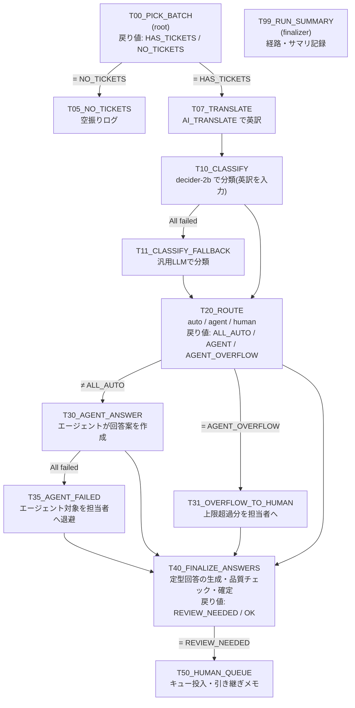

# SaaSカスタマーサポート × Decision × Cortex Agent パイプライン

架空のプロジェクト管理SaaS「TaskFlow」の問い合わせフォームに届いたチケットを分類し、次の3つに振り分けて処理するパイプラインの検証キットです。

| 振り分け | 対象 | 処理 |
|---|---|---|
| **auto** | ヘルプ記事だけで答えられる | 選ばれた記事を根拠に、定型回答を生成する |
| **agent** | ヘルプ記事に加えて、その顧客のデータ確認が必要 | Cortex Agent がヘルプ記事(Cortex Search)と顧客データ(Cortex Analyst)を調べて回答案を作る |
| **human** | 担当者の判断・権限・調査が必要 | 担当者キューに入れ、引き継ぎメモを生成する |

auto と agent の回答も品質チェックにかけます。基準を満たさないものは、下書きを付けて human に回します。

分類と品質チェックには、オープンウェイトの判定モデル **decider-2b**(jev-class decision model、Apache-2.0)を使います。Model Registry に登録し、SPCS のサービスとして SQL から呼び出します。decider-2b は選択肢ごとの確率を返すので、振り分けの閾値を確率で決められます。

Snowflake 純正の `snowflake-decision`(AI_COMPLETE)は Private Preview のため、この検証では使いません。

decider-2b が使えないとき(サービスの停止など)は、T11 が汎用LLMで分類し直します。品質チェックも、プロシージャの中で汎用LLMに切り替わります。

**日本企業での利用を想定し、問い合わせ・返信・顧客データ・ヘルプ記事はすべて日本語です。** decider-2b は英語で学習されたモデルなので、パイプラインの中で `AI_TRANSLATE` を使って英訳してから渡します(T07)。返信の生成は日本語のまま行います。英訳する場合としない場合の精度は、設定1つで切り替えて比べられます。

---

## 全体像



### 判定の中身

**T10:分類(decider-2b の `DECIDER_2B_SVC!SYSTEM_ONE`、1回の呼び出しで4項目)**

decider-2b は英語で学習されたモデルです。質問文は英語で書き、問い合わせ本文とヘルプ記事のタイトルは T07 で英訳したものを渡します。

**T07:英訳(`AI_TRANSLATE(text, 'ja', 'en')`)**
- 今回のバッチの問い合わせを英訳し、`TICKET_TRANSLATIONS` に保存します。
- ヘルプ記事のタイトルは、未翻訳のものだけ英訳して `KB_TRANSLATIONS` に蓄積します。
- 翻訳に失敗した行は日本語のまま T10 に渡し、`CLASSIFY_RESULTS.INPUT_LANG` に `ja` と記録します。翻訳全体が失敗しても T07 は成功扱いにして、分類を止めません。
- `translate_for_decider = 0` にすると英訳せずに日本語のまま渡すので、翻訳の効果を比べられます。

| 項目 | タイプ | 内容 |
|---|---|---|
| `category` | choice | 問い合わせの種類(8区分)。フォームで顧客が選んだ区分は誤っていることがある前提 |
| `kb_article` | choice | 回答に使えるヘルプ記事(18本+none)。選択肢は `KB_ARTICLES` から動的に組み立てる |
| `requires_human` | noul | 担当者の判断・権限・調査が必要か(返金、請求への異議、不正アクセス、データ削除、法務、管理者ロックアウト、未知の不具合、強い不満など) |
| `needs_account_data` | noul | その顧客固有のデータ(プラン、シート数、請求、API利用、障害影響)の確認が必要か |

**T20:振り分けのルール**(閾値は `PIPELINE_CONFIG` で変更)
- **human**:`requires_human` ≥ 0.5、または分類できなかった
- **auto**:記事が特定でき(確信度 ≥ 0.8)、かつ `needs_account_data` < 0.3
- **agent**:上記以外

**T40:品質チェック(decider-2b、失敗したら汎用LLM)**

問い合わせ・返信案・参照情報を英訳し(問い合わせは T07 の英訳を再利用)、JSON オブジェクトにまとめて STATE として渡します。

| 項目 | タイプ | 送信可の基準 |
|---|---|---|
| `grounded` | score(0〜2) | ≥ 1.2(参照情報で裏付けられているか) |
| `resolves` | noul | ≥ 0.5(質問に直接答えているか) |
| `risky` | noul | < 0.5(返金や期日の約束など、承認が必要な内容を含むか) |

参照情報は、auto なら選ばれたヘルプ記事です。agent ならエージェントが引用したヘルプ記事と、照会した顧客データの要約です。

---

## フォルダ構成

| ファイル | 実行方法 | 内容 |
|---|---|---|
| `setup/00_setup.sql` | ワークシートで1回 | ロール・WH・DB・`SUPPORT` スキーマ・権限 |
| `setup/01_synthetic_data.sql` | ワークシートで1回 | 合成データ(顧客・プラン・請求・API利用・障害・ヘルプ記事・チケット・正解ラベル) |
| `setup/02_search_semantic_view_agent.sql` | ワークシートで1回 | Cortex Search(ヘルプ記事)、セマンティックビュー(顧客データ)、回答エージェント |
| `setup/03_pipeline_objects.sql` | ワークシートで1回 | 設定値・出力テーブル・確認用ビュー |
| `setup/04_procedures.sql` | ワークシートで1回 | 各カードから呼ぶプロシージャ |
| `setup/05_decider_model.sql` | ワークシート + 手元のPC | decider-2b 用のコンピュートプール・外部アクセス・イメージリポジトリ、サービスの確認・停止 |
| `pipeline/T*.sql` | GUI の SQL カード | 1カード1ファイル。冒頭コメントに依存関係と条件を記載 |
| `pipeline/scenarios.sql` | ワークシート | 検証シナリオの切り替え |
| `pipeline/inspect.sql` | ワークシート | 経路・回答・担当者キュー・評価指標の確認 |
| `setup/99_teardown.sql` | 検証後に1回 | decider-2b のサービス・モデル・プールと `SUPPORT` スキーマを削除 |

---

## 手順

### A. Snowflake のリソースを作る

1. `setup/00` から `04` までを順にワークシートで実行する。
   - `02` の Cortex Search はインデックスの作成に少し時間がかかります。動作確認の `SEARCH_PREVIEW` が空なら、少し待ってから再実行してください。
   - `02` の最後の `DATA_AGENT_RUN` で、エージェントが顧客データを照会して回答することを確認してください。
### B. decider-2b を登録してサービスを起動する

公式サンプル [Snowflake-Labs/decision-models-in-snowflake-model-registry](https://github.com/Snowflake-Labs/decision-models-in-snowflake-model-registry) のスクリプトを、作成先だけ変えてそのまま使います。

1. `setup/05_decider_model.sql` の **[1]** をワークシートで実行する(ACCOUNTADMIN が必要です)。
   - GPU プール(`GPU_NV_S`、A10G x1)とビルド用の CPU プールを作ります。
   - あわせて、イメージビルド用の外部アクセス(PyPI / PyTorch のみ)とイメージリポジトリを作ります。
   - `GPU_NV_S` が使えないリージョンでは、ここで失敗します。
2. 手元の PC で公式サンプルを実行する。必要なもの:Python 3.12、Snowflake CLI の接続(**既定ロールを `DECISION_PIPE_ROLE` にする**)、約5GBの空き容量。

```bash
git clone https://github.com/Snowflake-Labs/decision-models-in-snowflake-model-registry
cd decision-models-in-snowflake-model-registry
python3.12 -m venv .venv && .venv/bin/pip install -r python/requirements.txt

# 重み(Mapika/decider-2b、リビジョン固定)をダウンロード
.venv/bin/hf download Mapika/decider-2b --revision 533964dae8be954c5b5e19fa4948e48408094c1e \
  --local-dir models/decider-2b

# 作成先をこのキットのスキーマに向ける
export SNOWFLAKE_CONNECTION_NAME=<DECISION_PIPE_ROLE を既定ロールにした接続名>
export DECIDER_BENCH_DATABASE=DECISION_PIPE_DB DECIDER_BENCH_SCHEMA=SUPPORT

.venv/bin/python python/log_model.py        # DECIDER_2B(バージョン SERVICE)を登録
.venv/bin/python python/create_service.py   # DECIDER_2B_SVC を起動(約15分)
```

   Windows の PowerShell の場合は、次のように読み替えてください。
   - `.venv/bin/` → `.venv\Scripts\`
   - `export A=B` → `$env:A = "B"`
   - 行末の `\` → 1行にまとめる

   サンプルの動作確認は macOS / Linux で行われています。Windows で依存関係のインストールに失敗する場合は、WSL を使ってください。
3. `setup/05_decider_model.sql` の **[2]** を実行する。サービスの状態が `READY` になり、日本語の問い合わせ1件に `answers` が返ることを確認してください。

> **費用に注意**:サービスは最小1インスタンスで起動したままになるため、GPU プールが常時課金されます。検証しない間は `05_decider_model.sql` の **[3]** でサービスとプールを止めてください。

### C. パイプラインを組んで実行する

1. Workspaces で、**DECISION_PIPE_ROLE が所有する共有ワークスペース**に `pipeline/` を置く。
2. Pipeline Builder を作成する(DCM プロジェクトの配置先は `DECISION_PIPE_DB.SUPPORT`)。
3. 下表のとおりカードを置いてつなぎ、条件を設定する。カード名は**表のとおり大文字で**付けてください(戻り値を参照する条件はタスク名の大文字・小文字まで一致させる必要があります)。
4. グラフの設定を行う。

| 設定 | 値 |
|---|---|
| Schedule | None(手動実行) |
| Config (JSON) | `{"batch_mode": "daily"}` |
| Task defaults | warehouse = `DECISION_PIPE_WH` |
| リトライ | 0 |
| Finalizer | `T99_RUN_SUMMARY` |

5. Deploy し、`scenarios.sql` でシナリオを切り替えながら Run して、`inspect.sql` で確認する。

### カードの設定

| カード | 前段 | Predecessors condition | Additional conditions |
|---|---|---|---|
| `T00_PICK_BATCH` | (root) | - | - |
| `T05_NO_TICKETS` | T00 | All succeeded | `SYSTEM$GET_PREDECESSOR_RETURN_VALUE('T00_PICK_BATCH') = 'NO_TICKETS'` |
| `T07_TRANSLATE` | T00 | All succeeded | `SYSTEM$GET_PREDECESSOR_RETURN_VALUE('T00_PICK_BATCH') = 'HAS_TICKETS'` |
| `T10_CLASSIFY` | T07 | All succeeded | - |
| `T11_CLASSIFY_FALLBACK` | T10 | **All failed** | - |
| `T20_ROUTE` | T10, T11 | **At least one succeeded** | - |
| `T30_AGENT_ANSWER` | T20 | All succeeded | `SYSTEM$GET_PREDECESSOR_RETURN_VALUE('T20_ROUTE') <> 'ALL_AUTO'` |
| `T31_OVERFLOW_TO_HUMAN` | T20 | All succeeded | `SYSTEM$GET_PREDECESSOR_RETURN_VALUE('T20_ROUTE') = 'AGENT_OVERFLOW'` |
| `T35_AGENT_FAILED` | T30 | **All failed** | - |
| `T40_FINALIZE_ANSWERS` | T20, T30, T31, T35 | **At least one succeeded** | - |
| `T50_HUMAN_QUEUE` | T40 | All succeeded | `SYSTEM$GET_PREDECESSOR_RETURN_VALUE('T40_FINALIZE_ANSWERS') = 'REVIEW_NEEDED'` |
| `T99_RUN_SUMMARY` | (finalizer) | 設定不可 | - |

`T30_AGENT_ANSWER` のタイムアウトは `agent_max_rows` × 120秒程度にしてください(既定は5件なので約10分)。

### シナリオと期待する経路

| シナリオ(`SP_SET_SCENARIO`) | 期待する経路 |
|---|---|
| `normal` | T00 → T07 → T10 → T20 → T30 → T40 → T50 → T99 |
| `classify_down` | T10(decider-2b)**失敗** → **T11**(汎用LLM)→ T20 → …(`DECIDER_2B_SVC` が無い・起動していない場合は normal でもこの経路) |
| `agent_down` | T30 **失敗** → **T35** → T40(agent の行は human)→ T50 |
| `overflow` | T20 (AGENT_OVERFLOW) → **T30 と T31 が並列** → T40 → T50 |
| `drained` | T00 (NO_TICKETS) → **T05** → T99(日曜でチケット0件の日も同じ) |
| `translate_for_decider = 0` | 経路は normal と同じ。T07 は何もせず、decider-2b に日本語のまま渡す(`inspect.sql` の 15 で英訳ありと比べる) |
| Config `batch_mode: all` | 未処理日をまとめて処理(overflow になりやすい) |

---

## 合成データ

すべて架空のデータで、Snowflake 上で生成します。HASH ベースの乱数なので、何度生成しても同じ結果になります。日本企業向けのサービスを想定し、値はすべて日本語です(列名と、評価用の分類コードは英字のまま)。

| テーブル | 内容 |
|---|---|
| `DIM_ACCOUNT` | 顧客40社(プラン、契約・利用シート数、状態(有効 / 支払遅延)、支払い方法、リージョン(東日本 / 西日本)、更新日) |
| `PLAN_LIMITS` | フリー / スタンダード / ビジネス / エンタープライズ の上限と料金 |
| `FACT_INVOICE` | 有料プランの請求書(2026年5〜9月分、支払済み / 未払い / 支払期限超過) |
| `FACT_API_USAGE_DAILY` | 10月のAPI利用。約3割の顧客で上限超過(429)が発生 |
| `INCIDENTS` | 障害4件(ファイル添付、通知メール、西日本リージョンのログイン、API) |
| `KB_ARTICLES` | ヘルプ記事18本(エージェントの検索対象・定型回答の根拠) |
| `SUPPORT_TICKETS` | 2026-10-02〜10-31 のチケット約220件(平日6〜13件、土日0〜2件) |
| `TICKET_LABELS` | 正解ラベル(評価専用。検索サービス・セマンティックビュー・エージェントからは参照できない) |

**チケットの内訳(正解の処理区分)**
- **kb(約45%)**:パスワード再設定、メンバー招待、タスク復元、エクスポート、Slack連携、APIキー、請求書の宛名、通知メール、添付上限、2段階認証、ダウングレード手順
- **lookup(約28%)**:9月分の請求金額と支払い状況、契約シート数、APIの上限(429)、特定日の障害と復旧時刻、ストレージ上限、請求書払いやSSOが使えるか(プランに依存)
- **human(約27%)**:返金依頼、請求金額への異議、不正ログインの疑い、データの即時削除と証明書、未知の不具合、解約をほのめかす苦情、値引き見積もり、DPA締結、唯一の管理者のロックアウト

**わざと紛らわしくしている点**
- 同じヘルプ記事に関係する問い合わせでも、正解の処理区分が分かれるようにしています。
  - KB002:2段階認証の設定方法は kb、唯一の管理者のロックアウトは human
  - KB017:ダウングレード手順は kb、返金依頼は human
- フォームの区分は2割が誤り(顧客が選び間違えた想定)です。

## 評価指標(`inspect.sql`)

| 指標 | 意味 | 目標 |
|---|---|---|
| `unsafe_automation` | 担当者が必要なのに自動で回答した件数 | **0** |
| `human_recall` | 担当者が必要な問い合わせのうち、human に回せた割合 | 1.0 |
| `automation_rate` | 自動で回答できる問い合わせのうち、実際に自動回答した割合 | 高いほど良い |
| `category_acc` | 種類の分類の正解率 | - |
| `kb_match` | 定型回答で選んだヘルプ記事が正解と一致した割合 | - |
| `fact_hit` | 顧客データが必要な問い合わせの回答に、正しい値(金額・上限・復旧時刻など)が含まれた割合 | - |

`inspect.sql` の 15・16 は翻訳の確認です。15 では、decider-2b に渡した言語(英訳 / 日本語)ごとに、分類・記事選択の正解率と要担当者の確率の分かれ方を比べます。16 では、翻訳の失敗件数と訳文のサンプルを見ます。

`inspect.sql` の 11〜14 は、decider-2b の確率そのものを見るためのクエリです。
- **11・12(確率の較正)**:確率の帯ごとに、実際の正解率と比べます。
- **13(閾値の比較)**:`human_min` の候補ごとに、取りこぼしと人手送りの件数を比べます。
- **14(処理時間)**:1件あたりの処理時間と入力トークン数を見ます。

`fact_hit` は、回答の文字列に期待値が含まれるかだけを見る簡易判定です。「1万回」のような表記の揺れは不一致として数えます。

## 調整ポイント(`PIPELINE_CONFIG`)

| KEY | 既定値 | 意味 |
|---|---|---|
| `human_min` | 0.50 | 要担当者の確率がこれ以上なら、最初から human |
| `auto_conf_min` | 0.80 | ヘルプ記事の確信度がこれ以上なら、定型回答の候補にする |
| `auto_data_max` | 0.30 | 顧客データが必要な確率がこれ未満なら、定型回答にする |
| `agent_max_rows` | 5 | 1回でエージェントに回す上限件数 |
| `agent_error_max` | 0.50 | エージェント呼び出しの失敗率の上限 |
| `quality_min` / `resolves_min` / `risk_max` | 1.20 / 0.50 / 0.50 | 送信可の基準 |
| `use_decider_for_quality` | 1 | 品質チェックで decider-2b を試す |
| `translate_for_decider` | 1 | decider-2b に渡す前に英訳する(0 で日本語のまま) |

安全側に倒したい場合は `human_min` を下げ、自動化率を上げたい場合は `auto_conf_min` を下げます。どちらも `unsafe_automation` と見比べながら調整してください。

---

## 未検証・要確認の点

手元では実行できていないため、実機で次の点を確認してください。

**decider-2b について**
- **翻訳を挟んだときの精度**:decider-2b のモデルカードは英語のみ対応としているため、T07 で英訳してから渡しています。英訳の品質(固有名詞や「シート」などの製品用語の訳し方)が判定に影響します。`inspect.sql` の 15・16 で、訳文と、英訳なしの場合との差を確認してください。
- **翻訳の費用と時間**:AI_TRANSLATE は問い合わせ1件ごとと、品質チェックの対象(返信案・参照情報)ごとに呼び出します。
- **choice の確信度**:`confidence` は「最大確率を一様分布で0、1つに集中で1になるよう換算した値」です。ヘルプ記事は19択なので、`auto_conf_min = 0.8` は最大確率がおよそ0.81以上に相当します。必要に応じて調整してください。
- **score の値**:`score` は段階の番号ではなく期待値(0〜2の小数)で返ります。`quality_min = 1.2` はこの期待値に対する閾値です。
- **戻り値の取り出し方**:ANSWER_JSON の取り出し方は、`decider-ai` 1.6.0 のソース(`systemone.py`)で確認した形式です。サービス関数の戻り値から `out:ANSWER_JSON` を取り出す方法は、公式サンプルの SQL に合わせています。初回は `CLASSIFY_RESULTS.RAW` を見てください。
- **費用**:GPU プール(GPU_NV_S)は、サービスが起動している間ずっと課金されます。

**パイプライン全般**
- **プロシージャ内からの戻り値設定**:`SYSTEM$SET_RETURN_VALUE` をプロシージャ(caller's rights)の中から呼んでいます。`inspect.sql` の 2 で、`RETURN_VALUE` に値が入っているか確認してください。
- **`<>` による条件(T30)**:通らない場合は、`= 'AGENT' OR ... = 'AGENT_OVERFLOW'` に変更してください。
- **埋め込みモデル**:`snowflake-arctic-embed-l-v2.0` を指定しています。リージョンで使えない場合は外してください。
- **汎用LLMのモデル名(`claude-sonnet-5`)**:アカウントやリージョンで使えるものに置き換えてください。
- **障害時のグラフの表示**:フォールバックで処理が完了しても、グラフ実行全体は失敗として表示される可能性があります。
