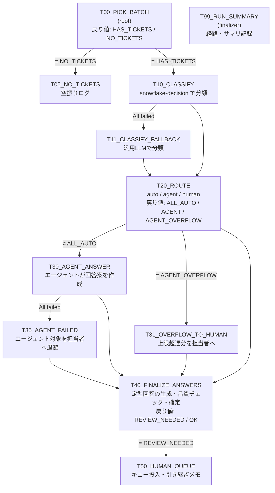

# SaaSカスタマーサポート × Decision × Cortex Agent パイプライン

架空のプロジェクト管理SaaS「TaskFlow」の問い合わせフォームに届いたチケットを分類し、次の3つに振り分けて処理するパイプラインの検証キットです。

| 振り分け | 対象 | 処理 |
|---|---|---|
| **auto** | ヘルプ記事だけで答えられる | 選ばれた記事を根拠に、定型回答を生成する |
| **agent** | ヘルプ記事に加えて、その顧客のデータ確認が必要 | Cortex Agent がヘルプ記事(Cortex Search)と顧客データ(Cortex Analyst)を調べて回答案を作る |
| **human** | 担当者の判断・権限・調査が必要 | 担当者キューに入れ、引き継ぎメモを生成する |

auto と agent の回答も品質チェックにかけます。基準を満たさないものは、下書きを付けて human に回します。

パイプラインの構成(分岐・フォールバック・ファイナライザー)は需要予測版と同じです。需要予測版は `archive_demand_forecast/` に移しました。

---

## 全体像

### 判定の中身

**T10:分類(snowflake-decision、1回の呼び出しで4項目)**

| 項目 | タイプ | 内容 |
|---|---|---|
| `category` | choice | 問い合わせの種類(8区分)。フォームで顧客が選んだ区分は誤っていることがある前提 |
| `kb_article` | choice | 回答に使えるヘルプ記事(18本+none)。選択肢は `KB_ARTICLES` から動的に組み立てる |
| `requires_human` | noul | 担当者の判断・権限・調査が必要か(返金、請求への異議、不正アクセス、データ削除、法務、管理者ロックアウト、未知の不具合、強い不満など) |
| `needs_account_data` | noul | その顧客固有のデータ(プラン、シート数、請求、API利用、障害影響)の確認が必要か |

**T20:振り分けのルール**(閾値は `PIPELINE_CONFIG` で変更)
- **human**:`requires_human` ≥ 0.5、または分類できなかった
- **auto**:記事が特定でき(確信度 ≥ 0.8)、かつ `needs_account_data` < 0.3
- **agent**:上記以外

**T40:品質チェック(snowflake-decision、失敗したら汎用LLM)**

| 項目 | タイプ | 送信可の基準 |
|---|---|---|
| `grounded` | score(0〜2) | ≥ 1.2(参照情報で裏付けられているか) |
| `resolves` | noul | ≥ 0.5(質問に直接答えているか) |
| `risky` | noul | < 0.5(返金や期日の約束など、承認が必要な内容を含むか) |

参照情報は、auto なら選ばれたヘルプ記事です。agent ならエージェントが引用したヘルプ記事と、照会した顧客データの要約です。

---

## フォルダ構成

| ファイル | 実行方法 | 内容 |
|---|---|---|
| `setup/00_setup.sql` | ワークシートで1回 | ロール・WH・DB・`SUPPORT` スキーマ・権限 |
| `setup/01_synthetic_data.sql` | ワークシートで1回 | 合成データ(顧客・プラン・請求・API利用・障害・ヘルプ記事・チケット・正解ラベル) |
| `setup/02_search_semantic_view_agent.sql` | ワークシートで1回 | Cortex Search(ヘルプ記事)、セマンティックビュー(顧客データ)、回答エージェント |
| `setup/03_pipeline_objects.sql` | ワークシートで1回 | 設定値・出力テーブル・確認用ビュー |
| `setup/04_procedures.sql` | ワークシートで1回 | 各カードから呼ぶプロシージャ |
| `pipeline/T*.sql` | GUI の SQL カード | 1カード1ファイル。冒頭コメントに依存関係と条件を記載 |
| `pipeline/scenarios.sql` | ワークシート | 検証シナリオの切り替え |
| `pipeline/inspect.sql` | ワークシート | 経路・回答・担当者キュー・評価指標の確認 |
| `setup/99_teardown.sql` | 検証後に1回 | `SUPPORT` スキーマを削除 |
| `archive_demand_forecast/` | - | 需要予測版(参考) |

---

## 手順

1. `setup/00` から `04` までを順にワークシートで実行する。
   - `02` の Cortex Search はインデックスの作成に少し時間がかかります。動作確認の `SEARCH_PREVIEW` が空なら、少し待ってから再実行してください。
   - `02` の最後の `DATA_AGENT_RUN` で、エージェントが顧客データを照会して回答することを確認してください。
2. Workspaces で、**DECISION_PIPE_ROLE が所有する共有ワークスペース**に `pipeline/` を置く。
3. Pipeline Builder を作成する(DCM プロジェクトの配置先は `DECISION_PIPE_DB.SUPPORT`)。
4. 下表のとおりカードを置いてつなぎ、条件を設定する。カード名は**表のとおり大文字で**付けてください(戻り値を参照する条件はタスク名の大文字・小文字まで一致させる必要があります)。
5. グラフの設定を行う。

| 設定 | 値 |
|---|---|
| Schedule | None(手動実行) |
| Config (JSON) | `{"batch_mode": "daily"}` |
| Task defaults | warehouse = `DECISION_PIPE_WH` |
| リトライ | 0 |
| Finalizer | `T99_RUN_SUMMARY` |

6. Deploy し、`scenarios.sql` でシナリオを切り替えながら Run して、`inspect.sql` で確認する。

### カードの設定

| カード | 前段 | Predecessors condition | Additional conditions |
|---|---|---|---|
| `T00_PICK_BATCH` | (root) | - | - |
| `T05_NO_TICKETS` | T00 | All succeeded | `SYSTEM$GET_PREDECESSOR_RETURN_VALUE('T00_PICK_BATCH') = 'NO_TICKETS'` |
| `T10_CLASSIFY` | T00 | All succeeded | `SYSTEM$GET_PREDECESSOR_RETURN_VALUE('T00_PICK_BATCH') = 'HAS_TICKETS'` |
| `T11_CLASSIFY_FALLBACK` | T10 | **All failed** | - |
| `T20_ROUTE` | T10, T11 | **At least one succeeded** | - |
| `T30_AGENT_ANSWER` | T20 | All succeeded | `SYSTEM$GET_PREDECESSOR_RETURN_VALUE('T20_ROUTE') <> 'ALL_AUTO'` |
| `T31_OVERFLOW_TO_HUMAN` | T20 | All succeeded | `SYSTEM$GET_PREDECESSOR_RETURN_VALUE('T20_ROUTE') = 'AGENT_OVERFLOW'` |
| `T35_AGENT_FAILED` | T30 | **All failed** | - |
| `T40_FINALIZE_ANSWERS` | T20, T30, T31, T35 | **At least one succeeded** | - |
| `T50_HUMAN_QUEUE` | T40 | All succeeded | `SYSTEM$GET_PREDECESSOR_RETURN_VALUE('T40_FINALIZE_ANSWERS') = 'REVIEW_NEEDED'` |
| `T99_RUN_SUMMARY` | (finalizer) | 設定不可 | - |

`T30_AGENT_ANSWER` のタイムアウトは `agent_max_rows` × 120秒程度にしてください(既定は5件なので約10分)。

### シナリオと期待する経路

| シナリオ(`SP_SET_SCENARIO`) | 期待する経路 |
|---|---|
| `normal` | T00 → T10 → T20 → T30 → T40 → T50 → T99 |
| `classify_down` | T10 **失敗** → **T11** → T20 → …(snowflake-decision 未有効化のアカウントでは normal でもこの経路) |
| `agent_down` | T30 **失敗** → **T35** → T40(agent の行は human)→ T50 |
| `overflow` | T20 (AGENT_OVERFLOW) → **T30 と T31 が並列** → T40 → T50 |
| `drained` | T00 (NO_TICKETS) → **T05** → T99(日曜でチケット0件の日も同じ) |
| Config `batch_mode: all` | 未処理日をまとめて処理(overflow になりやすい) |

---

## 合成データ

すべて架空のデータで、Snowflake 上で生成します。HASH ベースの乱数なので、何度生成しても同じ結果になります。

| テーブル | 内容 |
|---|---|
| `DIM_ACCOUNT` | 顧客40社(プラン、契約・利用シート数、支払い方法、リージョン、更新日) |
| `PLAN_LIMITS` | Free / Standard / Business / Enterprise の上限と料金 |
| `FACT_INVOICE` | 有料プランの請求書(2026年5〜9月分、支払済み / 未払い / 支払期限超過) |
| `FACT_API_USAGE_DAILY` | 10月のAPI利用。約3割の顧客で上限超過(429)が発生 |
| `INCIDENTS` | 障害4件(ファイル添付、通知メール、JP-Westのログイン、API) |
| `KB_ARTICLES` | ヘルプ記事18本(エージェントの検索対象・定型回答の根拠) |
| `SUPPORT_TICKETS` | 2026-10-02〜10-31 のチケット約220件(平日6〜13件、土日0〜2件) |
| `TICKET_LABELS` | 正解ラベル(評価専用。検索サービス・セマンティックビュー・エージェントからは参照できない) |

**チケットの内訳(正解の処理区分)**
- **kb(約45%)**:パスワード再設定、メンバー招待、タスク復元、エクスポート、Slack連携、APIキー、請求書の宛名、通知メール、添付上限、2段階認証、ダウングレード手順
- **lookup(約28%)**:9月分の請求金額と支払い状況、契約シート数、APIの上限(429)、特定日の障害と復旧時刻、ストレージ上限、請求書払いやSSOが使えるか(プランに依存)
- **human(約27%)**:返金依頼、請求金額への異議、不正ログインの疑い、データの即時削除と証明書、未知の不具合、解約をほのめかす苦情、値引き見積もり、DPA締結、唯一の管理者のロックアウト

**わざと紛らわしくしている点**
- 同じヘルプ記事に関係する問い合わせでも、正解の処理区分が分かれるようにしています。
  - KB002:2段階認証の設定方法は kb、唯一の管理者のロックアウトは human
  - KB017:ダウングレード手順は kb、返金依頼は human
- フォームの区分は2割が誤り(顧客が選び間違えた想定)です。

## 評価指標(`inspect.sql`)

| 指標 | 意味 | 目標 |
|---|---|---|
| `unsafe_automation` | 担当者が必要なのに自動で回答した件数 | **0** |
| `human_recall` | 担当者が必要な問い合わせのうち、human に回せた割合 | 1.0 |
| `automation_rate` | 自動で回答できる問い合わせのうち、実際に自動回答した割合 | 高いほど良い |
| `category_acc` | 種類の分類の正解率 | - |
| `kb_match` | 定型回答で選んだヘルプ記事が正解と一致した割合 | - |
| `fact_hit` | 顧客データが必要な問い合わせの回答に、正しい値(金額・上限・復旧時刻など)が含まれた割合 | - |

`fact_hit` は、回答の文字列に期待値が含まれるかだけを見る簡易判定です。「1万回」のような表記の揺れは不一致として数えます。

## 調整ポイント(`PIPELINE_CONFIG`)

| KEY | 既定値 | 意味 |
|---|---|---|
| `human_min` | 0.50 | 要担当者の確率がこれ以上なら、最初から human |
| `auto_conf_min` | 0.80 | ヘルプ記事の確信度がこれ以上なら、定型回答の候補にする |
| `auto_data_max` | 0.30 | 顧客データが必要な確率がこれ未満なら、定型回答にする |
| `agent_max_rows` | 5 | 1回でエージェントに回す上限件数 |
| `agent_error_max` | 0.50 | エージェント呼び出しの失敗率の上限 |
| `quality_min` / `resolves_min` / `risk_max` | 1.20 / 0.50 / 0.50 | 送信可の基準 |
| `use_decision_for_quality` | 1 | 品質チェックで snowflake-decision を試す |

安全側に倒したい場合は `human_min` を下げ、自動化率を上げたい場合は `auto_conf_min` を下げます。どちらも `unsafe_automation` と見比べながら調整してください。

---

## 未検証・要確認の点

手元では実行できていないため、実機で次の点を確認してください。

**最初に確認したいこと**
- **プロシージャ内からの戻り値設定**:`SYSTEM$SET_RETURN_VALUE` をプロシージャ(caller's rights)の中から呼んでいます。`inspect.sql` の 2 で、`RETURN_VALUE` に値が入っているか確認してください。
- **`<>` による条件(T30)**:通らない場合は、T30 の条件を `= 'AGENT' OR ... = 'AGENT_OVERFLOW'` に変更してください。
- **snowflake-decision の出力形式**:`choice` の選択肢を動的に組み立てた場合の挙動と、`score` が段階の番号(0〜2)で返るかどうかは、Private Preview のドキュメントで確認してください。初回は `CLASSIFY_RESULTS.RAW` と `FINAL_RESULTS.QUALITY_RAW` を見てください。

**環境に応じて変更が必要なもの**
- **埋め込みモデル**:`snowflake-arctic-embed-l-v2.0` は多言語対応のモデルとして指定しています。リージョンで使えない場合は外してください(既定のモデルは英語向けなので、日本語の検索精度は落ちます)。
- **汎用LLMのモデル名(`claude-sonnet-5`)**:アカウントやリージョンで使えるものに置き換えてください。`04_procedures.sql` の中で一括置換できます。

**その他**
- **障害時のグラフの表示**:フォールバックで処理が完了しても、グラフ実行全体は失敗として表示される可能性があります。
- **費用**:エージェントは1件あたり数十秒〜2分程度かかり、ウェアハウスと AI の費用が発生します。`agent_max_rows` で上限を設けています。
