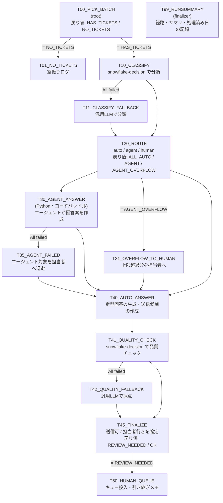

# Snowflake Pipeline Builderを使った Agent Workflowパイプラインを作成しよう！

架空のプロジェクト管理SaaS「TaskFlow」の問い合わせフォームに届いたチケットを分類し、次の3つに振り分けて処理するパイプラインの検証キットです。

| 振り分け | 対象 | 処理 |
|---|---|---|
| **auto** | ヘルプ記事だけで答えられる | 選ばれた記事を根拠に、定型回答を生成する |
| **agent** | ヘルプ記事に加えて、その顧客のデータ確認が必要 | Cortex Agent がヘルプ記事(Cortex Search)と顧客データ(Cortex Analyst)を調べて回答案を作る |
| **human** | 担当者の判断・権限・調査が必要 | 担当者キューに入れ、引き継ぎメモを生成する |

auto と agent の回答も品質チェックにかけます。基準を満たさないものは、下書きを付けて human に回します。

分類(T10)と品質チェック(T41)には、Snowflake の判定モデル **`snowflake-decision`** を `AI_COMPLETE` から使います。choice / score / noul(真偽)の質問に対して選択肢ごとの確率を返すので、振り分けの閾値を確率で決められます。

> Pipeline Builder は Public Preview、`snowflake-decision` は Public Preview です(2026-11-20 時点、[リリースノート](https://docs.snowflake.com/en/release-notes/2026/other/2026-11-20-ai-complete-snowflake-decision-public-preview))。利用の前に提供状況を確認してください。

判定モデルが使えないとき(エラーや強制失敗のシナリオ)は、T11 / T42 が汎用LLM(`AI_COMPLETE` の構造化出力)で分類・採点し直します。
日本企業での利用を想定し、問い合わせ・返信・顧客データ・ヘルプ記事はすべて日本語です。

---

## 全体像

パイプラインは DCM プロジェクト `TEST_WORKFLOW`(フォルダは `AGENT_WORKFLOW/`)の Pipeline Builder 定義(タスクグラフ `SUPPORT_PROCESSING`)です。

問い合わせ1件ごとの auto / agent / human は、T20 が `ROUTED_TICKETS.ROUTE` 列に書き込みます。各タスクはバッチ全体を処理し、その中で ROUTE 列によって対象を絞り込みます。タスクの戻り値(下図の `= ...`)は、バッチ全体の状態(対象があるか、エージェントの上限を超えたか、担当者行きがあるか)によって、後続のタスクを動かすかどうかを切り替えるために使っています。



### 判定の中身

**T10:分類(`AI_COMPLETE(model => 'snowflake-decision')`)**

問い合わせ本文(日本語)を `state` に、下の4つの質問を `questions` に渡します。

| 項目 | タイプ | 内容 |
|---|---|---|
| `category` | choice | 問い合わせの種類(8区分)。フォームで顧客が選んだ区分は誤っていることがある前提 |
| `kb_article` | choice | 回答に使えるヘルプ記事(18本+none)。選択肢は `KB_ARTICLES` のタイトルから動的に組み立てる |
| `requires_human` | noul | 担当者の判断・権限・調査が必要か(返金、請求への異議、不正アクセス、データ削除、法務、管理者ロックアウト、未知の不具合、強い不満など) |
| `needs_account_data` | noul | その顧客固有のデータ(プラン、シート数、請求、API利用、障害影響)の確認が必要か |

応答は `answers.<項目>.choice / confidence / probabilities`(choice)、`answers.<項目>.noul`(noul の確率)の形で返り、そのまま `CLASSIFY_RESULTS` に保存します(生の応答は `RAW` 列)。

**T20:振り分けのルール**(閾値は `PIPELINE_CONFIG` で変更)
- **human**:`requires_human` ≥ 0.5、または分類できなかった
- **auto**:記事が特定でき(確信度 ≥ 0.8)、かつ `needs_account_data` < 0.3
- **agent**:上記以外

**T41:品質チェック(`snowflake-decision`、失敗したら T42 の汎用LLM)**

問い合わせ・返信案・参照情報を JSON オブジェクト(`ticket` / `draft_reply` / `reference`)にまとめて `state` として渡します。

| 項目 | タイプ | 送信可の基準(T45) |
|---|---|---|
| `grounded` | score(0〜2) | ≥ 1.2(参照情報で裏付けられているか) |
| `resolves` | noul | ≥ 0.5(質問に直接答えているか) |
| `risky` | noul | < 0.5(返金や期日の約束など、承認が必要な内容を含むか) |

参照情報は、auto なら選ばれたヘルプ記事です。agent ならエージェントが引用したヘルプ記事と、照会した顧客データの要約です。

---

## フォルダ構成

| パス | 実行方法 | 内容 |
|---|---|---|
| `setup/00_setup.sql` | ワークシートで1回 | ロール・WH・DB・`SUPPORT` スキーマ・権限 |
| `setup/01_synthetic_data.sql` | ワークシートで1回 | 合成データ(顧客・プラン・請求・API利用・障害・ヘルプ記事・チケット・正解ラベル) |
| `setup/02_search_semantic_view_agent.sql` | ワークシートで1回 | Cortex Search(ヘルプ記事)、セマンティックビュー(顧客データ)、回答エージェント |
| `setup/03_pipeline_objects.sql` | ワークシートで1回 | 設定値・出力テーブル・確認用ビュー |
| `setup/99_teardown.sql` | 検証後に1回 | `SUPPORT` スキーマなどを削除 |
| `AGENT_WORKFLOW/` | DCM プロジェクト | パイプライン本体(下記) |

`AGENT_WORKFLOW/` の中身:

| パス | 内容 |
|---|---|
| `manifest.yml` | DCM プロジェクト `DECISION_PIPE_DB.SUPPORT.TEST_WORKFLOW`(所有ロール `DECISION_PIPE_ROLE`)と、T30 のコードバンドル用アセット |
| `sources/definitions/pipeline.yml` | タスクグラフ `SUPPORT_PROCESSING`(root・finalizer・`task_defaults`)とコードバンドル `T30_CB` |
| `sources/definitions/tasks/T*.yml` | 各タスクの定義(前段・条件・SQL 本体) |
| `bundles/t30/T30_AGENT_ANSWER.py` | T30 で実行する Python(エージェント呼び出し) |

---

## 手順

### A. Snowflake のリソースを作る

1. `setup/00` から `03` までを順にワークシートで実行する。
   - `02` の Cortex Search はインデックスの作成に少し時間がかかります。動作確認の `SEARCH_PREVIEW` が空なら、少し待ってから再実行してください。
   - `02` の最後の `DATA_AGENT_RUN` で、エージェントが顧客データを照会して回答することを確認してください。
2. `snowflake-decision` が使えることを確認する。

```sql
SELECT AI_COMPLETE(model => 'snowflake-decision', prompt => TO_JSON({
  'state': 'パスワードを忘れてログインできません。',
  'questions': {'category': {'type': 'choice', 'instructions': 'What is this support ticket about?',
    'criteria': {'account_access': 'Login, password or SSO', 'billing': 'Invoices or payments', 'other': 'Anything else'}}}}));
```

### B. パイプラインをデプロイする

1. Workspaces で `AGENT_WORKFLOW/` を開き、DCM プロジェクト `DECISION_PIPE_DB.SUPPORT.TEST_WORKFLOW` として **Plan** を実行する。
2. Plan の結果(作成・変更・削除されるタスク)を確認してから **Deploy** する。

グラフの設定(`pipeline.yml`):

| 設定 | 値 |
|---|---|
| Schedule | なし(手動実行) |
| Task defaults | warehouse = `DECISION_PIPE_WH` |
| Finalizer | `T99_RUNSUMMARY` |

`batch_mode` を Config で渡さない場合、T00 は `daily`(未処理の受付日を1日ずつ)で動きます。

### C. 実行して確認する

```sql
-- 通常実行(未処理の受付日を1日分)
EXECUTE TASK GRAPH DECISION_PIPE_DB.SUPPORT.SUPPORT_PROCESSING;

-- 未処理日をまとめて処理
EXECUTE TASK GRAPH DECISION_PIPE_DB.SUPPORT.SUPPORT_PROCESSING
  USING CONFIG = $${"batch_mode": "all"}$$;
```

- メンバーのタスクに `EXECUTE TASK` を使うとエラーになります。必ずグラフ単位で実行してください。
- 実行履歴は Snowsight のタスクグラフの Run History か、`TASK_HISTORY(GRAPH_ID => ...)` で確認します(グラフの ID は `SHOW TASK GRAPHS IN SCHEMA DECISION_PIPE_DB.SUPPORT`)。Run History が見えない場合は、Snowsight のロールを `DECISION_PIPE_ROLE` にしてください。
- **同じ日を処理し直すとき**:T99 が処理済みの受付日を `BATCH_STATE` に記録し、T00 はそこにない日から選びます。同じ日をやり直す場合は、その日の行を消してから実行します。各タスクは今回のバッチのチケットの行だけを消して入れ直すので、他の日の結果は残ります。

```sql
DELETE FROM DECISION_PIPE_DB.SUPPORT.BATCH_STATE WHERE RECEIVED_DATE = '2026-10-02';
EXECUTE TASK GRAPH DECISION_PIPE_DB.SUPPORT.SUPPORT_PROCESSING;
```

### 結果を見るテーブル

| テーブル | 内容 | 書き込むタスク |
|---|---|---|
| `FINAL_RESULTS` | チケットごとの最終結果(最終経路・カテゴリ・回答・人手理由・品質スコア) | T45 |
| `RUN_SUMMARY` / `RUN_TASK_STATES` | 実行ごとの集計と、タスクごとの状態 | T99 |
| `HUMAN_REVIEW_QUEUE` | 担当者キュー(下書き・引き継ぎメモ) | T31 / T35 / T50 |
| `CLASSIFY_RESULTS` | 分類結果(カテゴリ・記事・各確率・生の応答) | T10 / T11 |
| `ROUTED_TICKETS` | 振り分け結果 | T20 |
| `AGENT_RESULTS` | エージェントの回答・参照記事・顧客データ・エラー | T30 |
| `AUTO_ANSWERS` / `QUALITY_CANDIDATES` | 定型回答と、品質チェックの対象 | T40 |
| `QUALITY_SCORES` | 品質チェックの結果 | T41 / T42 |
| `PIPELINE_EVENTS` | イベントログ | 各タスク |

`CURRENT_BATCH` と結合すると、直近の実行で処理した日の分だけに絞れます。

### シナリオと期待する経路

`PIPELINE_CONFIG` の値を変えてから実行します。

```sql
-- 例: 分類モデル障害のシナリオ
UPDATE DECISION_PIPE_DB.SUPPORT.PIPELINE_CONFIG SET VALUE = 1 WHERE KEY = 'force_classify_failure';
```

| シナリオ | 設定 | 期待する経路 |
|---|---|---|
| 通常 | 既定値 | T00 → T10 → T20 → T30 → T40 → T41 → T45 → T50 → T99 |
| 分類モデル障害 | `force_classify_failure = 1` | T10 **失敗** → **T11**(汎用LLM)→ T20 → … |
| エージェント障害 | `force_agent_failure = 1` | T30 **失敗** → **T35** → T40(agent の行は human)→ … |
| 品質チェックモデル障害 | `force_quality_failure = 1` | T41 **失敗** → **T42**(汎用LLM)→ T45 → … |
| 処理量超過 | `agent_max_rows = 1` | T20(AGENT_OVERFLOW)→ **T30 と T31 が並列** → T40 → … |
| 処理対象なし | 全日を処理済みにする | T00(NO_TICKETS)→ **T01** → T99 |
| まとめて処理 | Config `batch_mode: all` | 未処理日をまとめて処理(overflow になりやすい) |

---

## 合成データ

すべて架空のデータで、Snowflake 上で生成します。HASH ベースの乱数なので、何度生成しても同じ結果になります。日本企業向けのサービスを想定し、値はすべて日本語です(列名と、評価用の分類コードは英字のまま)。

| テーブル | 内容 |
|---|---|
| `DIM_ACCOUNT` | 顧客40社(プラン、契約・利用シート数、状態(有効 / 支払遅延)、支払い方法、リージョン(東日本 / 西日本)、更新日) |
| `PLAN_LIMITS` | フリー / スタンダード / ビジネス / エンタープライズ の上限と料金 |
| `FACT_INVOICE` | 有料プランの請求書(2026年5〜9月分、支払済み / 未払い / 支払期限超過) |
| `FACT_API_USAGE_DAILY` | 10月のAPI利用。約3割の顧客で上限超過(429)が発生 |
| `INCIDENTS` | 障害4件(ファイル添付、通知メール、西日本リージョンのログイン、API) |
| `KB_ARTICLES` | ヘルプ記事18本(エージェントの検索対象・定型回答の根拠) |
| `SUPPORT_TICKETS` | 2026-10-02〜10-31 のチケット約220件(平日6〜13件、土日0〜2件) |
| `TICKET_LABELS` | 正解ラベル(評価専用。検索サービス・セマンティックビュー・エージェントからは参照できない) |

**チケットの内訳(正解の処理区分)**
- **kb(約45%)**:パスワード再設定、メンバー招待、タスク復元、エクスポート、Slack連携、APIキー、請求書の宛名、通知メール、添付上限、2段階認証、ダウングレード手順
- **lookup(約28%)**:9月分の請求金額と支払い状況、契約シート数、APIの上限(429)、特定日の障害と復旧時刻、ストレージ上限、請求書払いやSSOが使えるか(プランに依存)
- **human(約27%)**:返金依頼、請求金額への異議、不正ログインの疑い、データの即時削除と証明書、未知の不具合、解約をほのめかす苦情、値引き見積もり、DPA締結、唯一の管理者のロックアウト


## 評価指標(`RUN_SUMMARY`)

T99 が実行ごとに `RUN_SUMMARY` へ記録します。正解ラベル(`TICKET_LABELS`)と突き合わせた値です。

| 列 | 意味 | 目標 |
|---|---|---|
| `N_UNSAFE_AUTOMATION` | 担当者が必要なのに自動で回答した件数 | **0** |
| `N_MISSED_AUTOMATION` | 自動で回答できたのに担当者に回した件数 | 少ないほど良い |
| `N_AUTO` / `N_AGENT` / `N_HUMAN` | 最終経路ごとの件数 | - |
| `CATEGORY_ACC` | 種類の分類の正解率 | - |

確率の較正(確率の帯ごとの実際の割合)は、`CLASSIFY_RESULTS` の確率と `TICKET_LABELS` を突き合わせて確認してください。


## 調整ポイント(`PIPELINE_CONFIG`)

| KEY | 既定値 | 意味 |
|---|---|---|
| `human_min` | 0.50 | 要担当者の確率がこれ以上なら、最初から human |
| `auto_conf_min` | 0.80 | ヘルプ記事の確信度がこれ以上なら、定型回答の候補にする |
| `auto_data_max` | 0.30 | 顧客データが必要な確率がこれ未満なら、定型回答にする |
| `agent_max_rows` | 5 | 1回でエージェントに回す上限件数 |
| `agent_error_max` | 0.50 | エージェント呼び出しの失敗率の上限 |
| `quality_min` / `resolves_min` / `risk_max` | 1.20 / 0.50 / 0.50 | 送信可の基準 |
| `force_classify_failure` / `force_agent_failure` / `force_quality_failure` | 0 | 1 にすると T10 / T30 / T41 を強制的に失敗させる(フォールバックの確認用) |

安全側に倒したい場合は `human_min` を下げ、自動化率を上げたい場合は `auto_conf_min` を下げます。どちらも `N_UNSAFE_AUTOMATION` と見比べながら調整してください。

> `translate_for_decider` は旧構成の英訳用で、現在はどのタスクも参照しません。`KB_TRANSLATIONS` / `TICKET_TRANSLATIONS` テーブルも使われていません。

---

## 注意点・要確認の点

**snowflake-decision について**
- **choice の確信度**:`confidence` は最大確率をそのまま表す値ではありません(一様分布で0、1つに集中で1に近づく換算値)。ヘルプ記事は19択なので、`auto_conf_min = 0.8` の意味は実データの確率と見比べて調整してください。
- **score の値**:`score` は段階の番号ではなく、確率で重み付けした期待値(0〜2の小数)で返ります。`quality_min = 1.2` はこの期待値に対する閾値です。
- **noul の確率の分布**:`requires_human` などの確率は、旧モデルと分布が異なる可能性があります。実データの確率と正解ラベルを見比べて、`human_min` などの閾値を調整してください。

**パイプライン全般**
- **汎用LLMのモデル名(`claude-sonnet-5`)**:T11 / T40 / T42 / T50 で使っています。アカウントやリージョンで使えるものに置き換えてください。
- **障害時のグラフの表示**:フォールバックで処理が完了しても、グラフ実行全体は失敗(FAILED)として表示されます(失敗したタスクがあるため)。
- **埋め込みモデル**:Cortex Search に `snowflake-arctic-embed-l-v2.0` を指定しています。リージョンで使えない場合は外してください。
