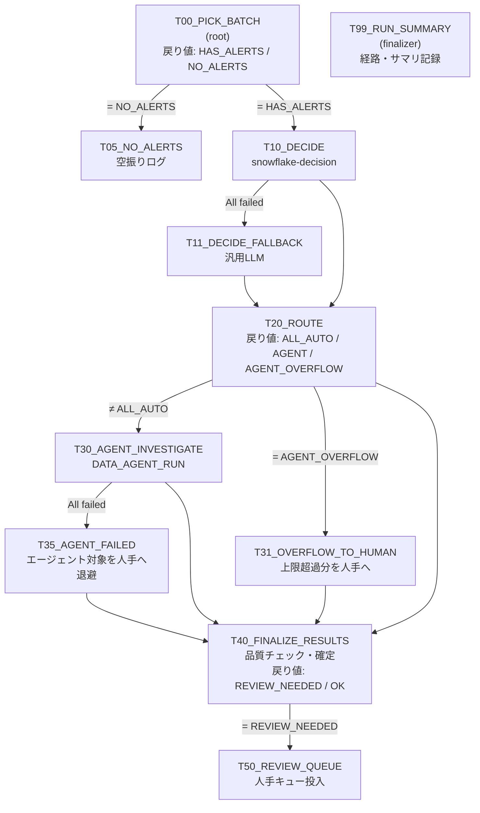

# Decision × Cortex Agent パイプライン検証キット

需要予測アラートを題材に、「判定モデルで仕分け → 難しいものだけエージェントで調査 → 品質チェック」の流れを検証するスクリプト一式です。
パイプラインは Pipeline Builder の GUI で組み立てます。ここにはそれ以外のリソースと、各カードで実行する SQL が入っています。

2つの構成があります。

| 構成 | フォルダ | 見どころ |
|---|---|---|
| **分岐版(推奨)** | `pipeline_branching/` | 戻り値による分岐、失敗時のフォールバック、上限超過時の並列処理、ファイナライザー、グラフ Config |
| 直列版 | `pipeline_linear/` | 10→20→30→40→50 の一本道。判定モデルの比較向け |

---

## 分岐版の全体像

T20 は「At least one succeeded」で T10 と T11 の両方を待ちます。T40 も「At least one succeeded」で、T20・T30・T31・T35 の4つすべてを待ちます。T99 はグラフのファイナライザーなので、途中で失敗しても必ず実行されます。

### Pipeline Builder で使っている機能

| 機能 | 使っている場所 |
|---|---|
| 戻り値で後続を切り替える(`SYSTEM$SET_RETURN_VALUE` → Additional conditions) | T00 → T05 / T10、T20 → T30 / T31、T40 → T50 |
| 前段の完了状態で切り替える(Predecessors condition) | T11(T10 が失敗したら動く)、T35(T30 が失敗したら動く) |
| 分岐の合流(At least one succeeded) | T20、T40 |
| ファイナライザー | T99(実行ごとに、各タスクの成功・失敗・スキップと戻り値を記録する) |
| グラフ Config (JSON) | T00 が `batch_mode` を読む(`daily` = 1日ずつ / `all` = 未処理日をまとめて) |

---

## フォルダ構成

| ファイル | 実行方法 | 内容 |
|---|---|---|
| `setup/00_setup.sql` | ワークシートで1回 | ロール・WH・DB/スキーマ・権限 |
| `setup/01_synthetic_data.sql` | ワークシートで1回 | 合成データ(店舗・品目・天候・実績/予測・アラート・正解ラベル) |
| `setup/02_semantic_view_and_agent.sql` | ワークシートで1回 | セマンティックビューと Cortex Agent |
| `setup/03_pipeline_objects.sql` | ワークシートで1回 | 設定・出力テーブル・エージェント実行プロシージャ(直列版でも使う) |
| `setup/04_branching_objects.sql` | ワークシートで1回 | **分岐版**のテーブル・プロシージャ・確認用ビュー |
| `pipeline_branching/T*.sql` | GUI の SQL カード | 1カード1ファイル。冒頭コメントに依存関係と条件を記載 |
| `pipeline_branching/scenarios.sql` | ワークシート | 検証シナリオの切り替え |
| `pipeline_branching/inspect.sql` | ワークシート | 通った経路・サマリ・キューの確認 |
| `pipeline_linear/*.sql` | GUI の SQL カード | 直列版 |
| `setup/99_teardown.sql` | 検証後に1回 | 全削除 |

---

## 分岐版の手順

1. `setup/00` → `01` → `02` → `03` → `04` を順にワークシートで実行する。
2. Workspaces で、**DECISION_PIPE_ROLE が所有する共有ワークスペース**に `pipeline_branching/` を置く。
3. Pipeline Builder を作成する(DCM プロジェクトの配置先は `DECISION_PIPE_DB.DEMO`)。
4. 下表のとおりカードを置いてつなぎ、条件を設定する。
   - カード名(タスク名)は**表のとおり大文字で**付ける。戻り値を参照するときは、スキーマなしのタスク名を大文字小文字まで一致させる必要がある。
5. グラフの設定を行う。
   - Schedule: None(手動実行)
   - Config (JSON): `{"batch_mode": "daily"}`
   - Task defaults: warehouse = `DECISION_PIPE_WH`
   - リトライ: 0(強制失敗のシナリオで同じ失敗を繰り返さないため)
   - Finalizer: `T99_RUN_SUMMARY`
6. Deploy し、`scenarios.sql` でシナリオを切り替えながら Run する。結果は `inspect.sql` で確認する。

### カードの設定

| カード | 前段 | Predecessors condition | Additional conditions |
|---|---|---|---|
| `T00_PICK_BATCH` | (root) | - | - |
| `T05_NO_ALERTS` | T00 | All succeeded | `SYSTEM$GET_PREDECESSOR_RETURN_VALUE('T00_PICK_BATCH') = 'NO_ALERTS'` |
| `T10_DECIDE` | T00 | All succeeded | `SYSTEM$GET_PREDECESSOR_RETURN_VALUE('T00_PICK_BATCH') = 'HAS_ALERTS'` |
| `T11_DECIDE_FALLBACK` | T10 | **All failed** | - |
| `T20_ROUTE` | T10, T11 | **At least one succeeded** | - |
| `T30_AGENT_INVESTIGATE` | T20 | All succeeded | `SYSTEM$GET_PREDECESSOR_RETURN_VALUE('T20_ROUTE') <> 'ALL_AUTO'` |
| `T31_OVERFLOW_TO_HUMAN` | T20 | All succeeded | `SYSTEM$GET_PREDECESSOR_RETURN_VALUE('T20_ROUTE') = 'AGENT_OVERFLOW'` |
| `T35_AGENT_FAILED` | T30 | **All failed** | - |
| `T40_FINALIZE_RESULTS` | T20, T30, T31, T35 | **At least one succeeded** | - |
| `T50_REVIEW_QUEUE` | T40 | All succeeded | `SYSTEM$GET_PREDECESSOR_RETURN_VALUE('T40_FINALIZE_RESULTS') = 'REVIEW_NEEDED'` |
| `T99_RUN_SUMMARY` | (finalizer) | 設定不可 | - |

`T30_AGENT_INVESTIGATE` は、カードのタイムアウトを `agent_max_rows` × 90秒程度にしてください(既定は5件なので約8分)。

### シナリオと期待する経路

| シナリオ(`SP_SET_SCENARIO`) | 期待する経路 | SKIPPED になるカード |
|---|---|---|
| `normal` | T00 → T10 → T20 → T30 → T40 → T50 ※1 → T99 | T05, T11, T31, T35 |
| `decision_down` | T00 → **T10 失敗** → **T11** → T20 → … | T05, (T31, T35) |
| `agent_down` | … → T20 → **T30 失敗** → **T35** → T40 → T50 → T99 | T05, T11, (T31) |
| `overflow` | … → T20 (AGENT_OVERFLOW) → **T30 と T31 が並列** → T40 → T50 → T99 | T05, T11, T35 |
| `drained` | T00 (NO_ALERTS) → **T05** → T99 | T10 以降すべて |
| Config `batch_mode: all` | 未処理日をまとめて1回で処理(overflow になりやすい) | - |

※1:T50 は人手行があるときだけ実行されます。日によって ALL_AUTO になる場合は、T30 も SKIPPED になります。

- **snowflake-decision が未有効化の場合**:`normal` でも T10 が失敗し、自然に T11 の経路になります。その状態をそのまま「判定モデル障害時のフォールバック」の検証として使えます。
- **バッチの進め方**:1回の Run で1日分を処理します。完了した日(`complete` / `no_alerts`)だけが処理済みになり、`incomplete` の日は次回の Run でもう一度処理されます。

---

## 合成データの設計

- **規模**:10店舗 × 15品目 × 120日(2026-07-04〜2026-10-31)、計18,000行。
- **異常の注入**:直近30日に以下の異常を入れ、予測誤差40%以上の行をアラート化しています(約300件)。

| 正解ラベル | 注入内容 |
|---|---|
| `promo` | 販促フラグON、実績 ×1.9 |
| `weather` | 豪雨(全品目 ×0.5、日用品 ×0.8)/ 猛暑(飲料・アイス ×1.8) |
| `stock` | 欠品フラグON、実績 ×0.3 |
| `unknown` | フラグなしで実績 ×1.7 または ×0.4 |

- **当日状況の有無**:アラートの約65%は、本文に当日状況(販促・欠品・気温・降水量)を含みます。残りは「未取得」なので、エージェントが調べないと原因を特定できません。
- **再現性**:乱数は HASH ベースなので、何度生成しても同じデータになります。
- **正解ラベルの隔離**:正解ラベル(`ALERT_LABELS`、`TRUE_CAUSE`)はセマンティックビューに含めていないため、エージェントからは参照できません。
- **日ごとの件数**:`V_BATCH_PREVIEW` で、各日のアラート件数と処理済みかどうかを確認できます。

## 調整ポイント(`PIPELINE_CONFIG`)

| KEY | 既定値 | 意味 |
|---|---|---|
| `auto_conf_min` | 0.80 | 原因判定の確信度がこれ以上なら、自動確定の候補にする |
| `auto_inv_max` | 0.30 | 要調査確率がこれ未満なら、自動確定にする |
| `agent_max_rows` | 5 | 1回でエージェントに回す上限件数。超えた分は T31 で人手へ回す |
| `quality_min` | 1.20 | 根拠スコア(0〜2)がこれ以上なら、エージェントの判定を採用する |
| `agent_error_max` | 0.5 | エージェント呼び出しの失敗率がこれを超えたら、T30 を失敗扱いにする |
| `use_decision_for_quality` | 1 | 品質チェックで snowflake-decision を試す(失敗したら汎用LLMに切り替える) |
| `force_decision_failure` / `force_agent_failure` | 0 | シナリオ用の強制失敗フラグ(`SP_SET_SCENARIO` が設定する) |

---

## 未検証・要確認の点

**分岐版で最初に確認したいこと**
- **プロシージャ内からの戻り値設定**:`SYSTEM$SET_RETURN_VALUE` をプロシージャ(caller's rights)の中から呼んでいます。`inspect.sql` の 2 で `RETURN_VALUE` が入っているか確認してください。入っていない場合、戻り値で分岐するカードはすべて SKIPPED になります。
- **戻り値条件での比較**:`<>` の比較(T30)が条件として通るか確認してください。通らない場合は、T20 の戻り値を `AGENT` と `AGENT_OVERFLOW` に絞り、T30 を `= 'AGENT' OR ... = 'AGENT_OVERFLOW'` にしてください。
- **失敗シナリオ時のグラフの状態**:フォールバックで処理が完了しても、グラフ実行全体は失敗として表示される可能性があります。エラー通知を設定している場合は、そのぶん通知も飛びます。
- **プレビュー機能**:Advanced branching はプレビュー機能です。条件を使うグラフでは全タスクがスケジュールされ、スキップしたタスクでも条件の評価にわずかなクラウドサービス料金がかかります。

**直列版と共通**
- **snowflake-decision の戻り値の型**:文字列でも VARIANT でも扱えるよう、`TRY_PARSE_JSON(TO_VARCHAR(...))` で吸収しています(分岐版のみ)。
- **エージェント定義の `execution_environment`**:エラーになる場合は、このブロックを削除してください。
- **汎用LLMのモデル名(`claude-sonnet-5`)**:アカウントやリージョンで使えるものに置き換えてください。
- **DATA_AGENT_RUN の第2引数**:バインド変数で渡しています。動かない場合は `EXECUTE IMMEDIATE` で組み立てる形に変更してください。
- **decider-2b**:分岐版には組み込んでいません。使う場合は `SP_DECIDE` の `decision` 分岐の INSERT を、`pipeline_linear/10c_decision_decider2b.sql` の内容に差し替えてください。
